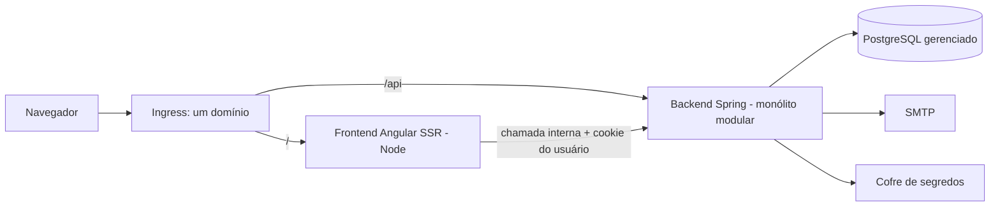
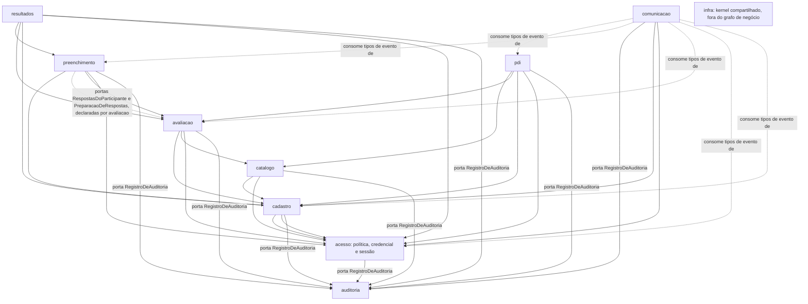
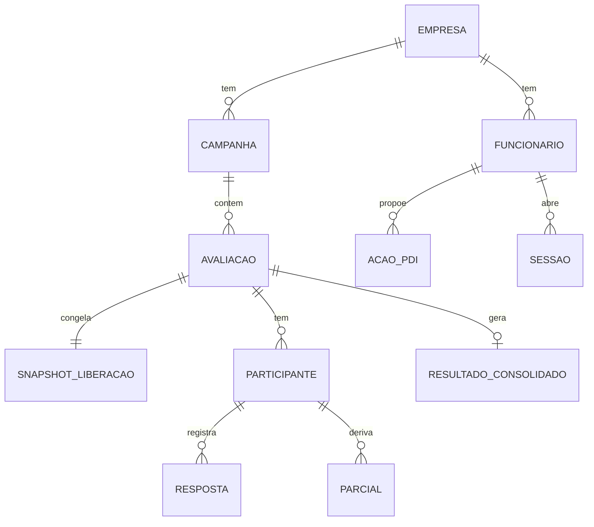

# Espinha de Arquitetura: DEZI novo

Tags: `[ADOPTED]` = escolhido pelo responsável nesta sessão (2026-10-13 a 2026-10-21). `[ASSUMPTION]` = padrão proposto, a corrigir na revisão. "a confirmar" = sem evidência ou sem decisão do negócio.

## Paradigma

**Monólito modular**, um deploy de backend, mais um frontend Angular SSR com deploy independente. Um módulo por capacidade; módulos só se falam pela API pública de cada um ou por eventos de domínio. A evolução futura a microsserviços é motivação, não escopo.



Módulos e direção de dependência (seta = "depende da API pública de"):



Regra do desenho: `acesso` não chama nenhum módulo (inversão pelas portas `EscopoOrganizacional` e `ResolucaoDeEmpresa`, declaradas por `acesso` e implementadas por `cadastro`, que já depende de `acesso`, sem ciclo, AD-19; a seta `cadastro --> acesso_api` do diagrama cobre a implementação). Os módulos de negócio chamam `acesso` pela porta `Autorizacao` (matriz do AD-4) e, no aceite do consenso, pela confirmação de senha (D53, sujeita ao AD-7). `resultados` lê o escopo de `cadastro` pela porta do AD-25. `cadastro` chama `acesso` de forma síncrona para aplicar situação e criar credencial (AD-24). Quando o dono A precisa de B e B depende de A, A declara a porta e B a implementa (AD-19). Nenhuma regra de negócio chama `comunicacao`: ela consome eventos de domínio (AD-21 canal 3) e chama `cadastro` (destinatário) e `acesso` (token) no consumidor (AD-22, AD-27). Todo módulo chama `auditoria` pela porta `RegistroDeAuditoria`, na mesma transação (AD-21 canal 1), não por evento. `infra` (fila, eventos publicados, contexto de empresa, relógio) é kernel que todos usam e não depende de módulo de negócio (AD-28). `resultados` lê só o snapshot de `avaliacao`, nunca `catalogo` (AD-9). Acrescentar aresta ao grafo exige editar esta espinha (AD-27).

## Invariantes e Regras

### AD-1 — Fronteiras de módulo verificadas no build [ADOPTED]

- **Binds:** todos os módulos: `acesso`, `cadastro`, `catalogo`, `avaliacao`, `preenchimento`, `resultados`, `pdi`, `comunicacao`, `auditoria`.
- **Prevents:** acoplamento por atalho (um módulo lendo tabela ou entidade de outro).
- **Rule:** cada módulo expõe uma API pública e esconde o resto. Teste de arquitetura (Spring Modulith `verify()`, com ArchUnit para regras extras) quebra o build se o grafo acima for violado ou surgir ciclo. Importação de planilhas vive em `cadastro` e `avaliacao`; motor de nota vive em `resultados`.

### AD-2 — Dono único dos dados, ligação só por id [ADOPTED]

- **Binds:** todos os módulos, modelo de dados.
- **Prevents:** duas escritas na mesma tabela por módulos diferentes; join entre módulos que impeça separar um módulo depois.
- **Rule:** cada tabela tem um módulo dono, único com escrita. Referência a outro módulo é por id, sem FK nem join entre módulos; leitura cruzada pela API pública. Toda tabela de negócio carrega `empresa_id`.

### AD-3 — Empresa vem da sessão; isolamento em duas camadas [ADOPTED]

- **Binds:** CAP-1, CAP-2 a CAP-10, D51, D57.
- **Prevents:** vazamento entre empresas por consulta sem filtro ou por parâmetro vindo do cliente.
- **Rule:** (1) filtro de empresa no repositório base da aplicação; (2) Row-Level Security no PostgreSQL, com a empresa em variável de sessão definida a cada transação e limpa ao devolver a conexão ao pool. A variável é definida com `set_config(..., true)` (escopo da transação) e a política falha fechada quando ela está ausente; `FORCE ROW LEVEL SECURITY` nas tabelas. O papel da aplicação não é dono das tabelas nem tem `BYPASSRLS`; jobs usam `app_rw` sob `paraEmpresa`, com `app_descoberta` só para enumerar e `app_manutencao` só para partições; a plataforma usa papel próprio. Pooler em modo transação só com a variável definida dentro da transação. A tabela de sessões fica fora da RLS (a busca precede a empresa conhecida). Nenhum endpoint recebe empresa como parâmetro, exceto o login, que recebe empresa e matrícula para resolver a empresa antes de existir sessão: `acesso` resolve a empresa pela porta `ResolucaoDeEmpresa` (declarada por `acesso`, implementada por `cadastro`, leitura da tabela `empresa`, fora da RLS, com `GRANT` de coluna só em `id`, `codigo`, `situacao` e fuso; o resto da configuração da empresa fica em `empresa_config`, com RLS), e empresa inexistente ou suspensa responde o mesmo 401 uniforme do AD-5. O administrador de plataforma, sem empresa, entra por endpoint próprio de plataforma, sobre o `DataSource` de plataforma (AD-29), com credencial em tabela própria de `acesso`, `credencial_plataforma`, sem `funcionario_id`, e TOTP (AD-7). A empresa no login é identificada por `empresa.codigo`, texto único e público, que a porta resolve. Worker de outbox, recálculo, job de recesso e importação processam por empresa, definindo a variável da empresa de cada item; varreduras entre empresas usam o papel `app_descoberta` (AD-20, AD-29) e só leem as colunas enumeradas no AD-28. Id de recurso de outra empresa responde 404. O administrador de plataforma cruza empresas por papel/política de banco explícito, nunca desligando o filtro. Todo SQL nativo precisa de teste de isolamento. Suporte a RLS do provedor: a confirmar.

### AD-4 — Matriz de autorização como fonte única declarativa [ADOPTED]

- **Binds:** CAP-1, D3, D10, D33, D34, D39, D40, D43, D52, D58, ACE-25.
- **Prevents:** `if` de perfil espalhado; menu da tela divergente do servidor; célula da matriz sem teste.
- **Rule:** uma tabela versionada em código define perfil × recurso × ação × escopo (próprio, árvore do par unidade/departamento, empresa, plataforma). Ela alimenta: (a) a checagem central no servidor (um ponto, não anotação por endpoint); (b) o endpoint que devolve as permissões do usuário ao Fuse para menu e botões; (c) um gerador de **teste negativo por célula**; (d) a regra de dois olhos (D52: quem é participante não conclui, cancela, reabre nem prorroga a própria avaliação). Dono do recurso lido do registro, nunca do corpo da requisição. Escopo de árvore resolvido pela porta `EscopoOrganizacional` (declarada por `acesso`, implementada por `cadastro`). O ponto central é o componente `Autorizacao.autorizar(sessao, acao_id, fatos)` de `acesso`, único chamado pelos demais módulos; `fatos` (dono, participantes, coordenada e estado do recurso) são lidos do registro pelo módulo chamador e passados, de modo que `acesso` aplica dois olhos (D52) e escopo sem chamar de volta nenhum módulo. A leitura da trilha de auditoria é autorizada pela porta `AutorizarLeitura`, declarada por `auditoria` e implementada por `acesso` (que já depende de `auditoria`), sem aresta nova. A matriz também carrega as regras de atribuição e de exceção do spec: ordem entre perfis (D10; ELI-12 a confirmar), prorrogar prazo e reabrir (D17, D32), aprovação de PDI sem aprovar o próprio (D22), exclusão de quem respondeu bloqueada (D12).

### AD-5 — Sessão no servidor com cookie opaco [ADOPTED]

- **Binds:** CAP-1, D41, D42, D53, D56, A1.
- **Prevents:** token roubável por XSS; sessão que sobrevive a troca de senha, de perfil ou a desligamento.
- **Rule:** identificador aleatório de 256 bits em cookie `__Host-`, `HttpOnly`, `Secure`, `SameSite=Lax`; no Postgres só o hash. Novo identificador a cada login. Expira por 30 min de inatividade e 10 h de teto absoluto (valores a confirmar com o negócio). A renovação da inatividade é um `UPDATE` em transação própria e curta, no máximo uma vez por minuto, fora da transação da requisição e da cadeia de locks do AD-19. Trocar senha, perfil ou situação, ou desligar, apaga todas as sessões do usuário na hora. Login: matrícula inexistente e senha errada dão o mesmo 401. Aceite do consenso (D53) exige a senha da própria parte, na própria sessão.

### AD-6 — Um domínio, sem CORS, CSRF explícito [ADOPTED]

- **Binds:** A10, D42, CAP-1.
- **Prevents:** CORS irrestrito com credenciais; CSRF por cookie automático.
- **Rule:** o ingress serve `/` (frontend) e `/api` (backend) sob o mesmo domínio; nenhuma configuração de CORS. Todo método que altera estado exige token anti-CSRF (padrão `XSRF-TOKEN`/`X-XSRF-TOKEN`, suportado pelo `HttpClient` e pelo Spring Security) e verificação de `Origin`. O SSR repassa o cookie do usuário nas chamadas à API, nunca cacheia resposta autenticada e não guarda estado de usuário no processo Node; o SSR só faz GET autenticado e o ingress aplica `Cache-Control: private, no-store` às respostas autenticadas. CSP com nonce e `allowedHosts` do SSR restritos ao domínio; comentários em texto livre são tratados como entrada não confiável (XSS armazenado). IP real vem de cabeçalho definido só pelo ingress (a confirmar na implantação).

### AD-7 — Credenciais, bloqueio e segundo fator [ADOPTED]

- **Binds:** D19, D29, D42, D56, D57, ELI-6, ELI-11.
- **Prevents:** bloqueio usado como negação de serviço; senha em texto; reset que derruba conta alheia; spraying de uma senha em muitas matrículas; rajada que contorna o contador; esgotamento de CPU por Argon2id.
- **Rule:** senha com 12+ caracteres, uma maiúscula, uma minúscula, um número e um caractere especial; troca a cada 90 dias (login forçado à troca e sessões invalidadas; a sessão nasce em `TROCA_DE_SENHA_PENDENTE`, com permissão só ao endpoint de troca, registrada na matriz do AD-4); recusa de senhas comuns/vazadas (fonte da lista: a definir); hash Argon2id com parâmetros no mínimo de m=19 MiB, t=2, p=1, dimensionados por teste de carga `[ASSUMPTION]`. Ordem do login, dentro do canal 2 do AD-21: (1) limite agregado por IP (janela deslizante, qualquer matrícula e empresa) e por empresa, antes de qualquer hash e antes de a empresa ser resolvida (esses contadores agregados estão na lista sem RLS do AD-28, sem `empresa_id`); (2) leitura atômica de `nao_antes_de` por (empresa, matrícula) e por (IP, empresa, matrícula); se no futuro, 429 uniforme com `Retry-After` e sem distinguir conta existente de inexistente, mas só quando a chave do IP também tem falhas recentes; quando só a chave por usuário está em atraso e o IP não tem falhas, segue ao passo 3; (3) verificação da senha (contra hash fictício quando a matrícula não existe, para tempo uniforme) com no máximo uma em andamento por matrícula (`pg_try_advisory_xact_lock`; perdeu o lock, 429); (4) falha: `INSERT … ON CONFLICT DO UPDATE … RETURNING` atômico que incrementa as falhas e recalcula `nao_antes_de`. O atraso nunca é `sleep` em thread. Bloqueio duro por (IP, empresa, matrícula): 5 falhas em 10 min e 25 em 20 min. Por usuário, de qualquer IP, só atraso progressivo com teto (padrão `min(2^(n-3) s, 15 min)` `[ASSUMPTION]`); durante o atraso, a senha correta vinda de IP sem falhas é aceita, para que terceiro não negue acesso à conta. A janela expira e não se renova; sucesso zera; o desbloqueio do RH limpa as duas famílias de chave da matrícula; administrador sem bloqueio permanente. Contadores em tabela própria de `acesso`, nunca na linha da credencial, no Postgres. Auditoria de falha é agregada (`BLOQUEIO_EM_MASSA`) quando o limite agregado estoura. Toda verificação de senha passa por uma única API de `acesso`, `confirmarSenha(sessao, finalidade)` (finalidade de lista fechada), com o mesmo funil (limite agregado, contador por sessão e por matrícula, lock, auditoria); isso vale ao aceite do consenso (D53) e à reautenticação do AD-8, executada em transação própria, antes da transação de negócio, e devolve uma prova de senha de uso único, atada à sessão e à finalidade, válida por 60 s, guardada em `prova_de_senha(empresa_id, sessao_id, finalidade, expira_em, consumida_em)` de `acesso` (com RLS) e consumida pela transação de negócio (o rollback desta devolve a prova; a linha é própria, sem outro lock de `acesso`) (assim `sessao` e o advisory não são tomados no meio dela); com contador próprio por sessão (5 falhas encerram a sessão), que não alimenta o atraso de login da matrícula; `PasswordEncoder` fora de `acesso` é proibido por teste de arquitetura. Critérios de aceite do CAP-1 incluem teste de password spraying e de rajada paralela. Link de senha (D56): uso único, com expiração, nunca para DESLIGADO, mesma resposta exista ou não a conta, invalida sessões. Administrador de plataforma exige TOTP com códigos de recuperação (biblioteca a escolher); a sessão marca "segundo fator verificado" e as ações do AD-8 pedem reautenticação recente. Segredo do TOTP guardado cifrado. 

### AD-8 — Trilha de auditoria imutável e na mesma transação [ADOPTED]

- **Binds:** D54, CAP-1, CAP-3, CAP-5, CAP-8.
- **Prevents:** ação privilegiada sem rastro; rastro editável.
- **Rule:** tabela só de inserção, gravada na mesma transação da ação pela porta `RegistroDeAuditoria` (AD-21 canal 1; não é evento nem listener). O dono da tabela é um papel diferente do da aplicação, que tem só `INSERT` e `SELECT` (`REVOKE` de `UPDATE`, `DELETE` e `TRUNCATE`), e gatilho recusa alteração. Isso não protege contra o dono do banco nem contra o administrador do provedor: o hash encadeado é a evolução prevista, em Adiado, com gatilho de adoção em auditoria externa ou exigência contratual. Registra quem, quando, o quê, motivo e empresa; o motivo é código de lista fechada, mantida no código-fonte e versionada com a matriz do AD-4, nunca texto livre; a justificativa digitada que o spec exige (cancelar e reabrir, D26 e D32) fica em registro acrescentado (append-only) do módulo dono da ação, `avaliacao_justificativa` (cancelar, prorrogar), `preenchimento_justificativa` (reabrir) ou `pdi_justificativa` (recusa de PDI, D22), anonimizável, e a trilha guarda só o código e o id do registro; matrícula digitada em login falho não entra na trilha, só contagem e hash; nunca senha nem conteúdo sensível (referência por id). Cobre: mudança de perfil, edição de catálogo, prorrogação, reabertura, cancelamento, reset e troca de senha, login e bloqueio, anonimização de titular, leitura de dado sensível (resultado individual, comentário) por perfil privilegiado e todo acesso do administrador de plataforma entre empresas. Encadeamento por hash reservado para exigência futura. Retenção: a confirmar.

### AD-9 — Congelamento na liberação, dono único: avaliação [ASSUMPTION sobre a forma; regra do spec]

- **Binds:** CAP-3, CAP-4, CAP-5, CAP-6, CAP-7, D4, D15, D23, D55.
- **Prevents:** edição do catálogo alterando avaliação liberada; quem entra depois lendo o catálogo atual; peso lido de fonte divergente.
- **Rule:** a liberação copia, numa única transação idempotente, a versão fixada do catálogo (AD-23: perguntas, dicas), escala, pesos (agentes, cargo×tipo, cargo×competência, pergunta) e cargo/departamento do avaliado, para tabelas de snapshot do módulo `avaliacao`. `preenchimento` e `resultados` leem só o snapshot, nunca `catalogo`. Falha deixa a avaliação em estado de erro recuperável com acompanhamento e aviso ao RH (D4). Participante tardio recebe a mesma versão (peso do momento da entrada: ELI-10, a confirmar). Resposta sem vínculo ao snapshot não é gravada. A unicidade da resposta é a chave canônica do AD-26, imposta no banco. O snapshot é escrito por um único serviço de `avaliacao` (AD-23).

### AD-10 — Estados e transições impostos no servidor [ASSUMPTION]

- **Binds:** CAP-5, CAP-6, CAP-8, D3, D13, D22, D26, D30, D32, D55.
- **Prevents:** transição genérica sem regra (o legado dependia da `commons`, D25); estado derivado divergente.
- **Rule:** cada agregado com ciclo de vida (avaliação, etapa do participante, ação de PDI) tem uma máquina de estados explícita, com tabela de transições (estado de origem, perfil, condição, efeito), uma única porta de entrada por agregado e evento de domínio por transição. Motivo obrigatório onde o spec exige (cancelar, reabrir). `CONCLUIDA` e `CANCELADA` são finais. Situação de preenchimento e `preenchida_avN` são derivados das respostas, nunca campo gravado. Prazo vale até o fim do dia no fuso da empresa (ELI-19, a confirmar). Relógio e prazo únicos: infraestrutura expõe `Relogio` (injetado) e `Prazo.vencido(dataLimite, fuso)`, com o fuso da empresa gravado no snapshot da liberação; só ele converte data limite em instante; data de transição é sempre do servidor; prorrogar (D17) grava nova `data_limite` com auditoria. A tabela de transições referencia a célula da matriz (`acao_id`, AD-4) para perfil e escopo e acrescenta só estado de origem, condição de dados e efeito; há gerador de teste por transição (origem × perfil × condição). `reabrir` (D32) atua sobre a etapa do participante, não sobre a avaliação `CONCLUIDA`; se o negócio quiser reabrir avaliação concluída, o consolidado passa a versionado (a confirmar).

### AD-11 — Nota por função pura única; parcial derivado; consolidado imutável [ADOPTED]

- **Binds:** CAP-7, D13, D15, D24, D37, D38, D39, D40, D55, D60, RES-5.
- **Prevents:** prévia diferente do consolidado; fórmula duplicada em relatório e tela; resultado que muda depois de concluído.
- **Rule:** o motor de nota é uma função pura, em `resultados`, sobre o snapshot da AD-9 (min-max D60; peso 0 exclui; vazio vira "sem nota"; consenso prevalece; NPA do consenso exclui). Ao finalizar uma etapa, um trabalho assíncrono idempotente, fila no Postgres, recalcula o parcial do participante; parcial é derivado e descartável; a tela mostra "atualizado em". Progresso e prévia saem da mesma fonte. Em `CONCLUIDA` há recálculo total e gravação do resultado imutável. A API aplica o escopo da AD-4 e o anonimato mínimo antes de devolver qualquer número. Corte: não há contador por gravação. A conclusão toma `FOR UPDATE` na avaliação (AD-19) e exclui por construção toda gravação posterior; a garantia é o estado: depois do `FOR UPDATE` nenhuma gravação nova é aceita (`garantirAberta`) e o total lê todas as respostas visíveis, sem filtro por tempo; o instante da transição (`clock_timestamp()` do Postgres, tomado sob o lock) é gravado só para registro, e o `Relogio` da aplicação serve a prazos, nunca ao corte. O total reagenda-se (`proxima_tentativa`) enquanto houver item de parcial da avaliação `PENDENTE` ou `EM_PROCESSAMENTO`, consultado sem `SKIP LOCKED`; parcial em `ERRO` é ignorado pelo total, que relê todas as respostas (parcial é descartável), e gera alerta. Parcial e total usam filas por classe de trabalho com cotas de workers separadas (AD-28). A exclusão entre parcial e total usa `pg_advisory_xact_lock(classid, objid)` (forma de dois inteiros do AD-19, com o hash de `avaliacaoId`) tomado por ambos. O consolidado é gravado com `INSERT` único por avaliação (unicidade no banco). Falha do total deixa a avaliação CONCLUIDA com "resultado pendente" retentável. Fórmula do legado é só referência de comparação (D24).

### AD-12 — Anonimato mínimo de agentes aplicado no servidor [ADOPTED o princípio; limiar a confirmar]

- **Binds:** CAP-7, D40, D52, ELI-2.
- **Prevents:** par ou subordinado identificável por média de um respondente.
- **Rule:** o servidor só exibe agente com respondentes ≥ limiar (parâmetro; proposta 3); abaixo disso agrega ao grupo "outros avaliadores"; a nota final usa todos os pesos. Tratamento de gestor direto e autoavaliação: a confirmar. Nunca identifica quem avaliou. O limiar vale por (agente, competência) sobre respondentes finalizados com nota. Se só um grupo ficar abaixo, é fundido ao próximo menor até atingir o limiar ("outros" nunca contém um único grupo identificável). A nota final só é exibida junto das notas por agente se a diferença não isolar um grupo suprimido (supressão complementar). Enquanto a avaliação não está `CONCLUIDA`, o acompanhamento nominal mostra só contagem por agente, nunca junto de parcial por grupo. O limiar efetivo é gravado no consolidado, que não muda se o parâmetro mudar depois.

### AD-13 — Comunicação por outbox transacional [ADOPTED]

- **Binds:** CAP-10, D18, D19, D27, D28, D29.
- **Prevents:** e-mail perdido entre commit e publicação; `ENVIADO` sem entrega; senha em texto.
- **Rule:** o evento de domínio (AD-21 canal 3) é a única origem do e-mail: a ação registra o evento na própria transação; o consumidor de `comunicacao`, idempotente por `evento_id`, resolve o destinatário e cria a linha do outbox. "Mesma transação" vale para o registro do evento, não para o e-mail. Envio em três tempos: tx1 reserva a linha (`ENVIANDO`, `tentativa_id`, lease) com `FOR UPDATE SKIP LOCKED` e termina; o envio ao SMTP ocorre fora de transação; tx2 marca `ENVIADO` ou `ERRO` (visível ao RH) com reenvio limitado e backoff. Reserva vencida volta à fila. Reenvio manual do RH tem intervalo mínimo e é auditado. Sem RabbitMQ por ora; a outbox serve de origem se um broker for preciso. Mensagem interna sempre gravada; e-mail sai só se o parâmetro da empresa e a caixa do destinatário permitirem. Credencial SMTP no cofre e rotacionada. Remetente e endereços de suporte por configuração. Segredo nunca persiste no corpo (AD-22).

### AD-14 — Jobs agendados seguros para várias instâncias [ASSUMPTION]

- **Binds:** D44, D56, D18, ELI-5.
- **Prevents:** job duplicado ou perdido com mais de uma instância.
- **Rule:** todas as instâncias agendam, uma executa, por lock no Postgres (ShedLock). Todo job é idempotente e registra evento (virada de recesso, expiração de link, reenvio de e-mail, recálculo). Os mecanismos assíncronos (AD-11 parcial e total, AD-13 outbox, AD-14 jobs, eventos do AD-21) usam a infraestrutura única do AD-28, de dono `infra`. Recesso derivado das datas ou gravado: ELI-5 a confirmar. Backend sem estado em memória; todo estado no Postgres.

### AD-15 — Contrato REST com OpenAPI como fonte única [ADOPTED]

- **Binds:** A10, CAP-1 a CAP-10.
- **Prevents:** deriva de contrato entre backend e frontend com deploys independentes.
- **Rule:** OpenAPI é a fonte; o cliente Angular é gerado dele; erros em Problem Details (RFC 9457); empresa nunca é parâmetro; build de ambos falha se o contrato divergir. Mudança incompatível exige versão do contrato. Convenções da API `[ASSUMPTION]`: concorrência otimista por versão do registro (`ETag`/`If-Match`), paginação por cursor ou página com limite máximo, e chave de idempotência (`Idempotency-Key`) nas operações de efeito externo ou irreversível (liberar, concluir, cancelar, importar). A tabela de chaves de idempotência é de `infra`, com `empresa_id`, e a chave vale por (empresa, usuário, operação). O `ETag` de um agregado com filhos (avaliação com participantes) cobre o agregado; contadores internos de `preenchimento` ficam fora dele.

### AD-16 — Frontend: Fuse como código nosso [ADOPTED]

- **Binds:** A1, A2, A5, A7, A9, U6.
- **Prevents:** peso e superfície de ataque do código de demonstração; dependência do ritmo do fornecedor.
- **Rule:** o template é copiado para o repositório do frontend com versões exatas fixadas; módulos de exemplo e dados fictícios são removidos na criação; ficam layout, tema, login (empresa + matrícula) e os componentes usados. SSR permanece ligado. Guard de rota e interceptor HTTP (cookie, XSRF, tratamento de 401/403) são construídos nesta base; menu e botões vêm das permissões da AD-4. pt-BR é o idioma padrão (Transloco), com o glossário do spec como terminologia. Atualização do Angular/TypeScript por decisão do time, em ciclo planejado.

### AD-17 — Importação de planilhas como módulo do backend [ADOPTED]

- **Binds:** A8, ACE-25, CRI-6, CAP-2, CAP-5.
- **Prevents:** regra de negócio no frontend ou em ferramenta à parte.
- **Rule:** upload pelo Fuse; processamento assíncrono no backend, respeitando AD-3 e AD-4; relatório de erros por linha, incluindo nomes não encontrados na planilha de pares. Limites de tamanho e de descompactação (zip bomb), parser XML sem entidades externas (XXE) e escape de fórmula ao exportar planilhas. O `support/` do legado é referência de formato, sem reaproveitar código. Limites adicionais: número de linhas, tempo de processamento e expansão de XML (XML bomb); retenção do arquivo enviado definida e curta. O job grava `ator = usuario:<id>` e `executado_por = sistema:<job>`, e o escopo do AD-4 é o do usuário, revalidado no processamento. Transação por linha ou por lote pequeno, com relatório por linha, nunca uma por planilha. O arquivo enviado fica em `bytea` numa tabela do módulo importador (`cadastro` ou `avaliacao`), com `empresa_id`, retenção curta e remoção após o processamento, para que as duas instâncias sem estado o leiam; troca por armazenamento de objetos é Adiado.

### AD-18 — Entrega, testes e operação [ADOPTED]

- **Binds:** AD-1, AD-3, AD-4, AD-15, CAP-10.
- **Prevents:** regras que dependem de "o build quebra" sem pipeline que as execute; ambiente de homologação inexistente; dado perdido sem backup.
- **Rule:** pipeline de CI executa, a cada mudança: build, teste de arquitetura (AD-1), teste negativo por célula (AD-4), teste de isolamento por empresa (AD-3, contra Postgres real com RLS em contêiner) e verificação do contrato OpenAPI (AD-15), nos repositórios de backend, de frontend e de `api-contract`; o `api-contract/` é contract-first `[ASSUMPTION]`, versionado em repositório próprio que os dois consomem. Deploys independentes de frontend e backend; ambiente de homologação com a mesma topologia da produção; migrações Flyway aplicadas antes do deploy do backend, compatíveis com a versão anterior (expandir e contrair). Backup e restauração do banco gerenciado com teste periódico de restauração; RPO/RTO a confirmar. Análise de dependências (SCA, ex. Dependabot) no CI dos dois repositórios, com política de patch. Logs estruturados, métricas e alerta de falha de outbox (`ERRO`), de job e de bloqueio em massa. Provedor de nuvem: a confirmar, e o suporte a RLS condiciona a escolha.

### AD-19 — Dono do agregado, portas inversas e guarda de estado [ADOPTED]

- **Binds:** CAP-5, CAP-6, D12, D26, D55, AD-1, AD-2, AD-10.
- **Prevents:** dois donos de `participante`/`resposta`; ciclo de dependência para saber se alguém respondeu; resposta gravada em avaliação CONCLUIDA ou CANCELADA por corrida.
- **Rule:** o ER anota o módulo dono de cada tabela, e o teste de arquitetura (regra ArchUnit própria; o `verify()` do Modulith não impõe isso) impede escrita em tabela por classe fora do dono. `participante` (pendência, datas, `removido_em`) é de `avaliacao`; `resposta` e `etapa_participante` (início, finalização, comentários finais, consenso liberado) são de `preenchimento`, único que escreve em `resposta`, inclusive as linhas vazias da liberação. Quando o dono A precisa de fato de um módulo B que depende de A, A declara uma porta e B a implementa: `avaliacao` declara `PreparacaoDeRespostas` (a liberação chama `preparar`) e `RespostasDoParticipante { existe, apagarRespostasEEtapas, bloquear }`, implementadas por `preenchimento`, resolvidas sem ciclo de beans (`ObjectProvider`; teste de partida). `garantirAberta(avaliacaoId, etapa, modo)` tem `modo ∈ {ESCRITA_RESPOSTA, PREPARACAO}`; `PREPARACAO` só vale dentro da transação da liberação, com a avaliação em `EM_LIBERACAO`. Toda escrita em `resposta`/`etapa_participante` obtém `garantirAberta` e `avaliacao.garantirParticipante(participanteId)` (participante ativo, `FOR SHARE`) na própria transação; concluir, cancelar, inativar e reabrir usam `FOR UPDATE` na linha da avaliação, e também adicionar, remover, trocar participante e aplicar pendência. Remoção de participante é lógica (`removido_em`), nunca física, para que resposta tardia seja recusada e não fique órfã. Ordem global de locks, que inclui a cadeia do AD-24: `funcionario` → `credencial_acesso` → `sessao` → `avaliacao` → `participante` → `etapa_participante` → `resposta` → `infra_sequencia` (várias linhas na mesma transação, sempre em ordem crescente de `agregado_tipo`, `agregado_id`) → advisory; todo `pg_advisory_xact_lock` usa a forma de dois inteiros (`classid` fixo por uso, registrado em `infra`, e `objid` = hash de 32 bits do id), nunca o id cru, e o advisory é tomado depois dos locks de linha, salvo o `try` do login (AD-7), que é a primeira instrução da sua própria transação e não toma lock de linha de negócio; nenhum caminho faz upgrade de `FOR SHARE` para escrita na mesma linha. Testes de concorrência obrigatórios: finalizar × concluir, gravar × cancelar, remover × gravar, N gravações paralelas sem deadlock e prorrogação com `If-Match` durante o preenchimento.

### AD-20 — Contexto de empresa fora de requisição [ADOPTED]

- **Binds:** AD-3, AD-11, AD-13, AD-14, AD-17.
- **Prevents:** worker sem empresa lendo zero linhas em silêncio; `BYPASSRLS` em produção; `SET` de sessão vazando no pool.
- **Rule:** um único componente `ContextoDeEmpresa` (infraestrutura compartilhada) com `emRequisicao()` e `paraEmpresa(id, motivo)`; ambos fazem só `set_config('app.empresa_id', id, true)` (equivalente a `SET LOCAL`) dentro da transação; `SET` de sessão e acesso a repositório fora de transação são proibidos (teste de arquitetura). Todo trabalho assíncrono carrega `empresa_id` na linha e executa sob `paraEmpresa`. Job periódico (recesso, expiração, troca de 90 dias, purga) não tem item de fila ainda: `infra` enumera as empresas ativas pela porta `EmpresasAtivas`, declarada por `infra` e implementada por `cadastro` sobre a view `empresa_ativa(id, situacao, fuso)`, executada no `DataSource` de `app_descoberta` e enfileira um item por (empresa, job), que roda sob `paraEmpresa`. Descobrir empresas com trabalho pendente usa o papel `app_descoberta` (AD-29), somente leitura, restrito às colunas enumeradas no AD-28; cada item é processado sob `paraEmpresa`. O papel da aplicação nunca tem `BYPASSRLS`. Auditoria de job registra `ator = sistema:<job>` e a empresa do item. Testes: dois tenants na fila com efeito só no tenant correto; conexão reutilizada sem variável residual. `ContextoDeEmpresa` tem também `novaTransacao(empresaId|PLATAFORMA)`, o único caminho para abrir `REQUIRES_NEW` (que não herda `SET LOCAL`); `Propagation.REQUIRES_NEW` direto é proibido (teste de arquitetura). `paraEmpresa` dentro de transação com outra empresa lança exceção (só repete a mesma). O nome da variável é `app.empresa_id` e a política lê `NULLIF(current_setting('app.empresa_id', true), '')`, fixados aqui para todas as migrações. Todo consumidor assíncrono entra por adaptador que lê `empresa_id` da linha (AD-28).

### AD-21 — Canais de evento distintos e nomeados [ADOPTED]

- **Binds:** AD-7, AD-8, AD-10, AD-13, D52, D54.
- **Prevents:** "evento" com três sentidos; auditoria perdida por listener assíncrono; falha de login que, ao dar rollback, apaga o próprio rastro e o contador.
- **Rule:** três canais. (1) `Auditoria`: porta `RegistroDeAuditoria.registrar(...)` chamada pelo dono da ação, na mesma transação; falha de gravação aborta a ação; não é listener. (2) `AuditoriaDeNegado`: transação própria (aberta por `ContextoDeEmpresa.novaTransacao`, AD-20) antes de lançar o erro, para login falho, bloqueio, 403 em ação privilegiada e o contador do AD-7. (3) `EventoDeDominio`: pelo menos uma vez, depois do commit, registrado na mesma transação em `infra_evento_publicado` (AD-28), consumidor idempotente por `evento_id`; usado por `comunicacao` e pelo parcial de `resultados`. `@ApplicationModuleListener`, `@TransactionalEventListener` e `@Async` são proibidos para o canal 1 (teste de arquitetura). Retenção: partição mensal e expurgo por remoção de partição, por função `SECURITY DEFINER` de `dono_auditoria` que se registra (AD-29); prazo a confirmar. Para cada caso do AD-8 há teste: ação que lança erro de negócio ainda deixa auditoria de negado. O contador de falhas e a auditoria de negado ficam em tabelas próprias, nunca na linha da credencial; a checagem de bloqueio usa `SELECT` sem lock. O canal 2 tem reserva dedicada de conexões e, com a reserva cheia, rejeita com 401/429 sem auditoria, contando em métrica (evita esgotar o pool com credenciais inválidas em paralelo). Login com empresa inexistente: contador numa tabela sem RLS, com TTL e teto de linhas por IP, e auditoria com `empresa_id` nulo na mesma tabela e partição mensal, com política de `INSERT` para `app_rw` só no canal 2 e `SELECT` só para `plataforma_ro`. Retenção por partição mensal vale igual para todas as empresas; prazo por empresa exigiria `DELETE`, que o gatilho do AD-8 recusa. O registro de publicação nativo do Spring Modulith não é usado (sem `empresa_id`, sem RLS, guarda dados pessoais serializados): o canal 3 usa `infra_evento_publicado` do AD-28.

### AD-22 — Segredo nunca persiste em corpo de mensagem [ADOPTED]

- **Binds:** AD-5, AD-13, D19, D29, D56.
- **Prevents:** token de link em claro no outbox, em log e na tela do RH.
- **Rule:** a linha da outbox guarda modelo + parâmetros não secretos; dado secreto entra como `segredo_ref` a um registro de vida curta em `acesso`. O worker pede a `acesso` a emissão do token no momento do envio (novo a cada tentativa; anteriores invalidados) e o corpo renderizado nunca é gravado. A tela do RH mostra modelo, destinatário e motivo do erro. Log e erro de SMTP passam por filtro que remove URLs com token. Após `ENVIADO` ou expiração, `segredo_ref` é apagado. Teste: nenhuma coluna de `comunicacao_*` nem `auditoria_*` contém token. O `segredo_ref` e o token são emitidos pelo worker na tx1 do AD-13 com `tentativa_id`; só o último token vale. Para link de senha, o e-mail do destinatário é lido de `cadastro` no momento do envio, nunca copiado do evento, para que o link não vá a endereço antigo.

### AD-23 — Catálogo versionado; snapshot fixado a uma versão [ADOPTED]

- **Binds:** CAP-3, CAP-5, AD-9, D23, D34, D48, D49.
- **Prevents:** "versão do catálogo" sem dono; participante tardio e cópia lendo o catálogo atual; aplicabilidade calculada por dois critérios; liberação lendo dois instantes.
- **Rule:** `catalogo` publica versões imutáveis (`versao_catalogo_id`) a cada edição confirmada; editar cria nova versão. `avaliacao` guarda `versao_catalogo_id` e, na liberação, copia ao snapshot o conjunto aplicável aos cargos presentes. Participante tardio com cargo ausente do snapshot lê a versão fixada por `catalogo.obterGabarito(versaoId, cargoId)`, nunca a corrente; se a versão não tem o cargo, é pendência. Aplicabilidade é de `catalogo` (`avaliarAplicabilidade(versaoId, cargoId, perfil)` devolve a lista ou motivo codificado); pendência e liberação chamam a mesma função. A liberação roda em `REPEATABLE READ`, com um lote `fotoDosAvaliados(ids)` de `cadastro` e um lote por versão de `catalogo`; inconsistência abandona e deixa o estado de erro recuperável. Cópia de avaliação usa a mesma versão por padrão; trocar para a corrente é opção explícita. O snapshot da pergunta tem `snapshot_pergunta_id` com `competencia_do_cargo_id` (D48/D49); respostas referenciam `snapshot_pergunta_id`. O snapshot é escrito por um único serviço de `avaliacao` (`completarParaCargo(avaliacaoId, cargoId)`), chamado na liberação e na entrada de participante tardio, sob o `FOR UPDATE` da avaliação e idempotente por (avaliação, cargo, `versao_catalogo_id`) com unicidade no banco; `preenchimento` e `resultados` nunca chamam `catalogo.obterGabarito`. Enquanto ELI-10 estiver aberto, o peso é o da versão fixada. O motor de nota trata o snapshot como crescente. A liberação roda: `BEGIN ISOLATION LEVEL REPEATABLE READ`, primeira instrução o `set_config('app.empresa_id', …, true)` do `ContextoDeEmpresa` (o `SET LOCAL` do AD-20 é esta mesma chamada), logo depois `SELECT … FOR UPDATE` da avaliação (que sob `REPEATABLE READ` pode falhar com `40001`, tratado abaixo), depois fotos, snapshot, `preparar` e estado `LIBERADA`. `40001` e `55P03` têm retry limitado (3) antes de qualquer transição; ERRO só para falha determinística (cargo sem gabarito, inconsistência de versão). Teste: liberar × prorrogar concorrentes termina com uma liberação válida.

### AD-24 — Dono por coluna lógica de `funcionario` [ADOPTED]

- **Binds:** AD-2, AD-5, D10, D11, D44, D45, D46, D50, D56.
- **Prevents:** credencial em tabela alheia; sessão viva após desligamento; duas unicidades de matrícula/e-mail.
- **Rule:** `cadastro` é dono de `funcionario` (identidade, e-mail, cargo, departamento, gestor, situação de trabalho). `acesso` é dono de `credencial_acesso` (matrícula de login, hash, perfil, bloqueios, sessões, TOTP), ligada por `funcionario_id`; perfil só muda por `acesso`. Mudança de situação (desligar, recesso, reativar, inclusive a virada automática D44) é feita por `cadastro` chamando `acesso.aplicarSituacao(funcionarioId, situacao)` na mesma transação, que revoga as sessões; evento assíncrono não serve para esse efeito. Login consulta só `credencial_acesso.situacao_acesso`. Unicidade de matrícula por empresa em `credencial_acesso`; de e-mail entre ativos em `funcionario`. Criar funcionário é operação de `cadastro` que cria a credencial pela API de `acesso` numa transação. Ordem de lock entre módulos: `funcionario` → `credencial_acesso` → `sessao`, que precede `avaliacao` na ordem global do AD-19. A porta `EscopoOrganizacional` (declarada por `acesso`) é de leitura sem lock, e `acesso` resolve o escopo antes de travar a credencial. Criação: `cadastro.criarFuncionario(dados, perfilInicial)` chama `acesso.criarCredencial(funcionarioId, matricula, perfilInicial)`; só `acesso` emite o evento de link de senha.

### AD-25 — Escopo: pares (unidade, departamento) e coordenada declarada [ADOPTED]

- **Binds:** AD-4, D33, D39, D43, D58, ELI-1.
- **Prevents:** N+1 e paginação errada por filtro em memória; resultado visível e PDI da mesma pessoa invisível por instantes diferentes da árvore.
- **Rule:** a porta devolve um conjunto de pares (unidade, departamento) do escopo (par e descendentes, D58), nunca ids de pessoas. Tabela com coordenada `congelada` guarda `unidade_id, departamento_id` (e o id do nó) e o módulo filtra por esses pares na própria consulta; tabela com coordenada `atual` não guarda cópia e junta com as views de `cadastro`. A matriz do AD-4 ganha a coluna "coordenada": `atual` (de `cadastro`) ou `congelada` (do snapshot). Enquanto ELI-1 estiver aberto, o padrão é `congelada` para avaliação, resultado, campanha e PDI vinculado a avaliação, e `atual` para funcionário e PDI sem avaliação. O teste negativo por célula cobre lista paginada (nenhum item fora do escopo; total só do escopo). Coordenada `atual` não é copiada para outro módulo: `cadastro` publica duas views como API pública, ambas com `security_invoker = true` (nome, colunas e RLS fixos, teste de esquema): `escopo_visivel(empresa_id, ator_funcionario_id, unidade_id, departamento_id)`, os pares visíveis ao ator (D58), e `lotacao_atual(empresa_id, funcionario_id, unidade_id, departamento_id)`; a porta `EscopoOrganizacional` é implementada sobre a mesma view, sem segundo critério; é a única exceção à restrição de join do AD-2, e a regra de expansão de "par e descendentes" (D58) vive em `cadastro`. Coordenada `congelada` é carimbada por `avaliacao` na liberação, dentro da mesma transação `REPEATABLE READ` do snapshot (AD-23), com o par e também o id do nó da hierarquia, gravado para histórico e relatório; unidade extinta ou fundida permanece em `cadastro` como nó com `sucessor_id`, e `escopo_visivel` inclui os pares dos nós extintos sob o escopo do sucessor, para que o resultado congelado não saia do alcance do gestor, e nunca é atualizada; antes da liberação vale `atual`; o vínculo de PDI avulso a uma avaliação grava a coordenada congelada dela; campanha carimba a coordenada do criador ao ser criada. A coluna "coordenada" é obrigatória para cada recurso da matriz do AD-4.

### AD-26 — Forma canônica da resposta e completude única [ADOPTED]

- **Binds:** CAP-6, CAP-7, AD-9, AD-10, AD-11, U5.
- **Prevents:** três modelos de resposta; três definições de "completa"; consenso gravado por um módulo e derivado por outro.
- **Rule:** a chave canônica de `resposta` é `(dono, snapshot_pergunta_id, etapa)` com etapa ∈ {AV1, AV2, AV3}, única no banco, onde o dono é `participante_id` em AV1 e AV2 e `par_de_consenso_id` em AV3 (restrição de verificação garante exatamente um dos dois); quantos consensos existem por avaliado quando há mais de um avaliador: a confirmar; "agente" é atributo do participante e não da chave (o AD-9 cita esta chave). Guarda `graduacao_snapshot_id` ou NPA e `observacao`; sem colunas por etapa. `par_de_consenso(avaliacao_id, avaliado_participante_id, avaliador_participante_id)`, de `preenchimento`, liga Av1 (do avaliado) e Av2 (do avaliador); a linha AV3 pertence ao par, e o aceite do consenso (D31, D53) é `aceite_consenso(par, parte, autor, em)`, também de `preenchimento`, apagado ao reabrir (D32). A liberação cria só AV1 e AV2; AV3 é materializada ao liberar o consenso e recalculada na reabertura. `preenchimento` expõe `Igualdade(Av1, Av2)` (mesmo `graduacao_snapshot_id`, ou ambos NPA; nunca por valor numérico), usada por `resultados`. Consenso derivado de Av1 = Av2 é calculado na leitura, nunca gravado; AV3 contém linha só para divergentes. Dois estados com dono: `completa` (derivado por `progressoDaEtapa`, toda pergunta da etapa com graduação ou NPA e comentário onde o nível exige) e `finalizada` (gravada em `etapa_participante`, só alcançável se `completa`; reabrir apaga a finalização). Gatilho do parcial, acompanhamento e `resultados` usam essas definições, sem recontar por SQL próprio. A API em lote `progressoDasEtapas(participanteIds[], etapa)` devolve mapa com `atualizadoEm`; a listagem de acompanhamento usa a página de participantes do escopo e uma chamada em lote.

### AD-27 — Contrato de evento e grafo completo [ADOPTED]

- **Binds:** AD-1, AD-13, D18, D27, D28, D29.
- **Prevents:** `comunicacao` sem endereço lendo outro módulo ou copiando funcionários; PII gorda em evento; aresta de dependência não declarada.
- **Rule:** todo evento de domínio é um tipo versionado (`v1`) na `api` do emissor, com `evento_id`, `empresa_id`, `ocorrido_em` e ids de destinatário (`funcionario_id`); o adaptador de entrada de `comunicacao` resolve nome, e-mail e preferência de aviso chamando `cadastro` no consumidor, sob `paraEmpresa` (aresta `comunicacao --> cadastro` no grafo); `comunicacao` guarda só o necessário ao envio, com retenção do outbox, e não lê tabela de outro módulo. O grafo do diagrama é a lista verificada de dependências; acrescentar aresta exige editar esta espinha. Mudança incompatível de evento exige novo tipo (`v2`), com os dois publicados durante a transição.

### AD-28 — Infraestrutura assíncrona única [ADOPTED]

- **Binds:** AD-11, AD-13, AD-14, AD-20, AD-21, AD-2.
- **Prevents:** consumidor sem empresa lendo zero linhas em silêncio na reinicialização; fila sem dono; duas origens do e-mail; evento fora de ordem; tabela de infraestrutura sem RLS por improviso.
- **Rule:** o módulo `infra` (kernel, fora do grafo de negócio) é dono único de `infra_trabalho` (fila: `empresa_id`, `tipo`, `agregado_id`, estado, tentativas e `proxima_tentativa`), de `infra_evento_publicado` (registro imutável, sem estado: `evento_id`, `empresa_id`, `tipo`, `agregado_tipo`, `agregado_id`, `sequencia`, `ocorrido_em`, carga) e de ShedLock, chaves de idempotência, `infra_sequencia`, `infra_consumo` e `infra_consumo_falha`; o consumidor descobre o pendente comparando `infra_evento_publicado.sequencia` com `infra_consumo.ultima`, e `app_descoberta` (única fonte da lista de colunas, referida pelos AD-3, AD-20 e AD-29) tem `SELECT` só em: `infra_trabalho(empresa_id, id, tipo, estado, proxima_tentativa)`, `infra_evento_publicado(empresa_id, tipo, agregado_tipo, agregado_id, sequencia)`, `infra_consumo(empresa_id, consumidor, agregado_tipo, agregado_id, ultima)` e a view `empresa_ativa`; sem linha em `infra_consumo` de um consumidor do registro estático de consumidores (código), `ultima = 0`; `infra_evento_publicado` expõe também `tipo` para que o consumidor só acorde com tipo que assina; `infra_sequencia` não é lida por `app_descoberta`; o avanço de `infra_consumo` é gravado na mesma transação do efeito; `infra_evento_publicado` e `infra_consumo` são expurgados 30 dias depois de consumidos por todos; a API do `infra` acumula os eventos da transação e grava `infra_sequencia` no pré-commit, em ordem crescente; módulos de negócio só enfileiram pela API do `infra`. Todo consumidor (listener de evento, worker de outbox, job, reenvio da partida) entra por um adaptador que lê `empresa_id` da linha e abre `ContextoDeEmpresa.paraEmpresa`; listener sem o adaptador é proibido (teste de arquitetura sobre a base `ConsumidorDeEvento`). Ordem por agregado: a `sequencia` é atribuída por upsert numa linha própria de `infra` (`infra_sequencia(empresa_id, agregado_tipo, agregado_id, ultima)`), na transação que emite, última entre os locks de linha na ordem do AD-19, para que a ordem de commit coincida com a numeração sem escrever em tabela de outro módulo; a numeração cobre todos os tipos do agregado. O consumidor percorre todas as linhas do agregado, avança sobre as de tipo que não assina, guarda a última sequência em `infra_consumo(empresa_id, consumidor, agregado_tipo, agregado_id, ultima)` (`infra_evento_publicado` é só o registro imutável do evento; o estado vive por consumidor) e só adia quando falta uma sequência cuja transação ainda não comitou (alerta se a lacuna passa de X min); descarta apenas sequência já processada. Evento venenoso (a contagem é gravada em transação própria, por `ContextoDeEmpresa.novaTransacao`, para sobreviver ao rollback do consumidor): após N tentativas o consumidor o marca `ERRO` em `infra_consumo_falha(empresa_id, consumidor, evento_id, tentativas, motivo)`, avança além dele, alerta, e o reprocessamento manual é idempotente. Filas por classe de trabalho com cotas de workers. Alertas: consumidor atrasado (evento mais antigo sem consumo há mais de X min), lacuna de sequência há mais de X min, idade máxima da fila e por empresa. Lista explícita de tabelas sem RLS, cada uma com o motivo: de `cadastro`, `empresa` (só `id`, `codigo`, situação e fuso, lida antes de a empresa ser conhecida); de `acesso`, `sessao` (carrega `empresa_id`, mas é buscada antes de a empresa ser conhecida), `sessao_plataforma`, `credencial_plataforma`, `totp_plataforma` e `recuperacao_totp_plataforma` (sem empresa) e o contador de login por IP e por empresa inexistente (sem empresa); de `infra`, `shedlock`. O contador por (empresa, matrícula) e o por (IP, empresa, matrícula) têm RLS e são lidos depois de `ResolucaoDeEmpresa`, sob `paraEmpresa`, com teste de esquema: toda tabela com `empresa_id`, inclusive as de `infra` (`infra_trabalho`, `infra_evento_publicado`, `infra_sequencia`, `infra_consumo`, chaves de idempotência), tem política e `FORCE`, e `app_descoberta` tem política `SELECT` explícita nas tabelas de fila, limitada às colunas enumeradas por `GRANT` de coluna; toda tabela fora da lista falha o build.

### AD-29 — Papéis de banco [ADOPTED]

- **Binds:** AD-3, AD-8, AD-20, AD-21.
- **Prevents:** requisição de plataforma sem papel definido; expurgo de auditoria por papel capaz de adulterar a trilha; papéis sem tabela de privilégios.
- **Rule:** `app_rw` (RLS, DML, sem `BYPASSRLS`, só `INSERT`/`SELECT` em auditoria), `app_descoberta` (leitura das colunas enumeradas das filas e da view `empresa_ativa`, AD-20), `plataforma_ro` e `plataforma_rw` (só endpoints de plataforma, `DataSource` próprio, política RLS explícita, atada ao papel e não à variável de sessão). `app_manutencao` (papel do job de partições, só `EXECUTE` das funções de auditoria). Funções `SECURITY DEFINER` pertencem a `dono_auditoria` (`NOLOGIN`, sem `BYPASSRLS`, dono da tabela-mãe e das partições), com `search_path` fixo, `REVOKE` de `PUBLIC` e `EXECUTE` só a `app_manutencao` (papel do job, sem `INSERT` nem `DELETE` na trilha): `expurgar_particao_auditoria` remove só partição vencida, com o prazo embutido na função, e `criar_particao_auditoria` cria as partições dos próximos 3 meses; um job de `infra` as chama e alerta se faltar partição futura. Sem partição `DEFAULT` (ela impediria criar a partição do mês): se faltar partição, a ação auditada aborta (falha fechada), por isso a migração inicial cria a partição do mês e as dos 3 meses seguintes, o job as mantém e o alerta dispara com mais de 2 meses de antecedência; a falha de gravação do canal 2 (AD-21) conta em métrica e alerta, sem derrubar o login. Ambas as funções se registram. A migração cria a tabela-mãe de auditoria e transfere o dono a `dono_auditoria` na própria migração (`migracao` é membro de `dono_auditoria` para isso). Migrações rodam com papel próprio (`migracao`), distinto de `app_rw`, dono das tabelas de negócio e com `BYPASSRLS` apenas se o provedor o permitir, só para backfill de migração, usado só pelo pipeline e fora do pool da aplicação (senão o backfill roda por empresa); credencial no cofre, com dono e rotação. Teste de privilégios no CI, inclusive de `app_manutencao` e das funções: nenhum papel de aplicação altera, trunca nem desabilita gatilho da trilha. Cifra em trânsito (TLS ao banco) e em repouso (do provedor) são requisito; segredos no cofre.

### AD-30 — Dados pessoais e LGPD [ADOPTED]

- **Binds:** AD-8, AD-11, AD-21, AD-29.
- **Prevents:** direito do titular que colide com consolidado e auditoria imutáveis; dado pessoal em texto livre na trilha imutável; retenção sem prazo.
- **Rule:** a empresa cliente é a controladora e o DEZI o operador (DPA a firmar). O catálogo de dados pessoais por tabela e a retenção por categoria ficam junto do esquema. Eliminação ou anonimização de titular anonimiza `funcionario` e referências; auditoria e consolidado guardam ids, não nomes, e o motivo de auditoria é código fechado (AD-8), então a imutabilidade se preserva. `cadastro` conduz a anonimização: chama `acesso.anonimizarCredencial(funcionarioId)` (credencial, sessões, contadores) e a porta `EliminacaoDeTitular.anonimizar(funcionarioId)`, declarada por `cadastro` e implementada por `comunicacao` (outbox, mensagem interna), `preenchimento` (`resposta.observacao`, comentários finais), `avaliacao` e `pdi` (justificativas e texto livre) e `resultados` (consolidado e comentários), todos já dependentes de `cadastro`; as tabelas `avaliacao_justificativa`, `preenchimento_justificativa` e `pdi_justificativa` (agregado, ocorrida_em, autor_id, texto) são append-only e só mudam pela anonimização do titular; a ação exige `confirmarSenha`, consta na lista "Cobre" do AD-8, e as eliminações ficam em registro reaplicável após restaurar backup; o valor anonimizado é único e irreversível, gerado só por `cadastro`; IP e matrícula na auditoria e nos contadores são truncados ou guardados como HMAC com segredo do cofre (hash simples é reversível por enumeração); o catálogo é artefato testado (toda coluna marcada pessoal tem tratador). A anonimização roda em transação própria por módulo, na ordem `acesso`, `comunicacao`, `preenchimento`, `avaliacao`, `pdi`, `resultados`; só altera campos de identificação e texto livre, nunca nota, estado nem o consolidado imutável do AD-11, o que a torna exceção declarada a `garantirAberta`. O consolidado guarda `funcionario_id`, cargo e unidade, o que é pseudonimização e não anonimização plena; se isso basta é decisão jurídica, assim como backups e IP de acesso. Incidente tem responsável; o DPA fixa o prazo em que o operador avisa a controladora, que responde pela comunicação à ANPD. Região do provedor (transferência internacional) a confirmar. Base legal, DPO e prazos: a confirmar com o jurídico.

## Convenções de Consistência

| Tema | Convenção |
| --- | --- |
| Nomes | Módulos e pacotes em português sem acento, minúsculos (`avaliacao`); tabelas `snake_case` singular; prefixo do módulo no nome da tabela `[ASSUMPTION]`. |
| Ids e datas | Identificadores opacos (UUID) `[ASSUMPTION]`; instantes em UTC com fuso; prazos no fuso da empresa (a confirmar). |
| Erros | Problem Details (RFC 9457); 401 único no login (429 uniforme com `Retry-After` durante o atraso ou bloqueio, AD-7); 404 para recurso de outra empresa; 403 só quando o recurso é visível ao usuário. |
| Estado e exclusão | Exclusão lógica e histórico onde o spec exige; unicidade garantida no banco (D46). |
| Eventos | Auditoria pela porta `RegistroDeAuditoria` na transação da ação (AD-21 canal 1); comunicação e parciais por evento de domínio e fila de `infra` no Postgres, após o commit (AD-28). |
| Esquema | Migrações Flyway versionadas no repositório `[ASSUMPTION]`; o esquema é do novo, sem herdar o do legado. |
| Configuração e segredos | Segredos no cofre do provedor, nunca no repositório; configuração por ambiente. |
| Observabilidade | Logs estruturados com identificador de requisição, sem dado pessoal nem segredo `[ASSUMPTION]`. |

## Stack (semente; versões a fixar no scaffolding)

| Nome | Versão |
| --- | --- |
| JDK | 25 (LTS) |
| Spring Boot | 4.1.1 (GitHub releases, 2026-08-20; verificado em 2026-10-21) |
| Spring Modulith `verify()` (ArchUnit como complemento) | 2.1.1 (Maven Central e blog spring.io, 2026-08-26; linha 2.1 GA em 2026-06-11 acompanha o Boot 4.1; verificado em 2026-10-21); compatibilidade com Boot 4.1.1 provada em projeto descartável (2026-10-21). Pacote `api` de cada módulo exige `@NamedInterface`, senão o `verify()` reprova. O `verify()` não impõe dono de tabela (AD-19): regra ArchUnit própria |
| PostgreSQL gerenciado | 18 (18.6 em 2026-08, site oficial); provedor e suporte a RLS a confirmar |
| Flyway | 13.11.1 (compatibilidade com Boot 4.1.1 e PostgreSQL 18.6 provada em projeto descartável em 2026-10-21); o Boot 4.1.1 gerencia 12.4.0; fixar 13.11.1 sobrescreve o BOM por decisão registrada, com teste de partida e migração no CI como critério de aceite; voltar ao 12.4.0 se o teste falhar |
| Argon2id | via Spring Security, depende do Bouncy Castle; mínimo m=19 MiB, t=2, p=1 (AD-7) |
| ShedLock | 7.10.1 (compatibilidade com Boot 4.1.1 provada em projeto descartável em 2026-10-21) |
| Cliente OpenAPI e TOTP | gerador do cliente Angular e biblioteca TOTP a escolher; suporte do `typescript-angular` ao Angular 22 não confirmado |
| Angular / TypeScript (Fuse) | 22.1.1 / 6.0.3, fixos; existem no npm; Node ^22.22.3 \|\| ^24.15.0 \|\| >=26 |
| Pisos de patch (no scaffolding, ao fixar versões) | Tomcat 11.0.25 ou superior, Bouncy Castle 1.85 ou superior, pgjdbc 42.7.12 ou superior; Angular 22.2.3 ou superior antes da produção (advisories de SSR e hidratação), compatibilidade com o Fuse a testar |
| Material, Tailwind 4, Transloco 8, ApexCharts | as do Fuse |
| Desenvolvimento local | Docker Compose |

## Semente Estrutural

```text
dezi-backend/
  src/main/java/.../<modulo>/   # api (pública) + internal (oculto) por módulo
  src/main/resources/db/migration/
  src/test/                     # testes de arquitetura, de isolamento e negativos por célula
dezi-frontend/                  # Fuse limpo, Angular SSR
  src/app/core/                 # guard, interceptor, permissões
  src/app/domains/<modulo>/
api-contract/                   # openapi.yaml, fonte do cliente gerado
```

Entidades centrais (nomes e relações). Donos (AD-19, AD-24): `funcionario` e `empresa` em `cadastro`; `credencial_acesso` e `sessao` em `acesso`; `participante` e `snapshot_liberacao` em `avaliacao`; `infra_trabalho`, `infra_evento_publicado`, chaves de idempotência e ShedLock em `infra` (AD-28); `resposta` e `etapa_participante` em `preenchimento`; `parcial` e `resultado_consolidado` em `resultados`; `acao_pdi` em `pdi`.



Ambientes: desenvolvimento local em Docker Compose; produção em nuvem gerenciada com banco gerenciado, duas instâncias do backend sem estado atrás de balanceador (postura provisória), frontend com deploy próprio. RPO/RTO: a confirmar.

## Mapa Capacidade → Arquitetura

Indicativo: a fonte são os `Binds` de cada AD.

| Capacidade | Vive em | Governado por |
| --- | --- | --- |
| CAP-1 Acesso e perfis | `acesso` | AD-3 a AD-8, AD-20 a AD-22, AD-24, AD-29, AD-30 |
| CAP-2 Cadastro | `cadastro` | AD-2, AD-3, AD-14, AD-17, AD-24, AD-30 |
| CAP-3 Catálogo | `catalogo` | AD-8, AD-9, AD-23 |
| CAP-4 Escalas | `catalogo` | AD-9 |
| CAP-5 Ciclo da avaliação | `avaliacao` | AD-8, AD-9, AD-10, AD-17, AD-19, AD-23 |
| CAP-6 Preenchimento | `preenchimento` | AD-9, AD-10, AD-19, AD-26 |
| CAP-7 Resultados e acompanhamento | `resultados` | AD-4, AD-9, AD-11, AD-12, AD-25, AD-26, AD-28 |
| CAP-8 PDI | `pdi` | AD-4, AD-8, AD-10 |
| CAP-9 Apontamento e feedforward | `pdi` (a confirmar: módulo próprio se crescer) | AD-4, AD-8, AD-10, AD-30 |
| CAP-10 Comunicação | `comunicacao` | AD-13, AD-14, AD-21, AD-22, AD-27, AD-28 |

## Adiado

| Tema | Por que pode esperar |
| --- | --- |
| Hash encadeado da auditoria | Sem exigência de prova de adulteração hoje. |
| Broker (RabbitMQ) | Volume medido no legado em 2026-10-13 (memlog: 144 avaliações, 166 mil linhas de preenchimento) não exige; a outbox é a origem. |
| Particionamento das tabelas de negócio (a da auditoria é mensal, AD-21) | Mesmo com 20 vezes o legado (premissa `[ASSUMPTION]`, sem projeção do negócio), poucos GB. |
| Hospedagem do Node SSR, TLS e fonte do IP real no ingress, dimensionamento dos pools por `DataSource`, rotação de segredos e configuração por ambiente | Dependem do provedor de nuvem, em aberto; decidir com ele, dono: responsável de infraestrutura a designar. |
| Separação física de módulos | Fronteiras já preparam a migração. |
| Importação de resultados do legado | D59: o novo começa com campanhas novas. |
| Gráficos (A6) | Depende da UX (U3) e da validação da fórmula com o negócio. |
| Armazenamento de arquivos (foto, planilhas) e relatórios/exportações PDF/Excel | Sem Pentaho (D24), cada módulo gera o relatório dos seus dados; armazenamento de objetos do provedor, a definir com o provedor. Exportação reusa a API do módulo dono, que já aplica escopo (AD-4) e anonimato (AD-12); o arquivo de importação está no AD-17. |

## Decisão Pendente: Mobile (A3)

Sem posição do responsável. Não decidido aqui.

| Opção | Prós | Contras | Impacto no escopo |
| --- | --- | --- | --- |
| **1. Web responsivo** (mesmo Fuse) | Um só cliente e um só conjunto de regras (D30); sessão por cookie (AD-5) serve; menor custo. | Sem notificação push nativa; offline limitado. | Preenchimento (U1) projetado mobile-first; nenhum módulo novo. |
| **2. Web instalável (PWA)** | Mantém um cliente; ícone na tela inicial; push web em parte dos dispositivos (suporte no iOS: a confirmar). | Comportamento varia por navegador. | Mesmo que 1, mais manifesto e política de cache segura (AD-6). |
| **3. App nativo ou híbrido** (como o Ionic do legado) | Push, loja, melhor experiência de dispositivo. | Segundo cliente a manter; exige token com refresh rotativo e detecção de reuso no módulo `acesso`; risco de regras duplicadas (o legado liberava consenso diferente, D30); ciclo de lojas. | Novo mecanismo de autenticação; D33 e D39 testados também no cliente móvel; esforço e prazo maiores. |

Qualquer das opções não altera os demais módulos; só a opção 3 adiciona o mecanismo de token ao módulo `acesso`.

## Decisões que dependem do negócio

1. **A3 Mobile** (acima).
2. **A4 Licença Envato:** o DEZI será cobrado dos clientes e a Standard cobre isso? Se não, Extended.
3. **Anonimato (AD-12):** limiar (proposta 3); como tratar gestor direto e autoavaliação; destino de pares/subordinados abaixo do limiar.
4. **Bloqueio de conta (AD-7):** decidido (atraso progressivo por usuário, bloqueio duro por IP+matrícula); falta fixar os valores do atraso e do teto.
5. **Tempos de sessão** (30 min e 10 h), **retenção da trilha de auditoria** e **fonte da lista de senhas vazadas**. Valores do atraso progressivo (AD-7) e política de 90 dias contra o NIST 800-63B: mantida por decisão do responsável.
6. **RPO/RTO**, provedor de nuvem e suporte a RLS; **crescimento** além de 20 vezes o legado. Se o provedor não oferecer RLS, o isolamento cai para a camada 1 do AD-3 e exige nova decisão.
   **LGPD (AD-30):** base legal, DPO, prazos e atendimento a titulares, com o jurídico.
7. **Pendências do spec com recomendação, ainda sem decisão:** ELI-1 (escopo do gestor: árvore atual ou da liberação), ELI-3 (mudança de gestor após liberar), ELI-4 (competência sem nota), ELI-5 (recesso derivado ou gravado; o job é idempotente de qualquer forma), ELI-7 (participante tardio), ELI-9 (pendência sem gestor), ELI-10 (peso do participante tardio), ELI-12 (ordem entre perfis), ELI-14 (PDI na árvore), ELI-16 (gestor de topo), ELI-17 (acesso em recesso), ELI-19 (prazo até o fim do dia), ELI-20 (substituir avaliador que respondeu), ELI-22 (contingência com um só administrador).
8. **D48 e D60:** reuso de pergunta entre competências (a confirmar) e escala sem amplitude (a confirmar). Pontos ★ de `a-confirmar.md` (ACE-6, ORG-1, CRI-2) já estão decididos (D10, D11, peso relativo).

## Decisões que dependem da UX (U1–U6)

- **U1** Tela de preenchimento (escala, "Não posso avaliar", comentário obrigatório, progresso por etapa, sem stepper pronto).
- **U2** Consenso: aceite com a própria senha (D31, D53) e liberação com Av1 e Av2 finalizadas (D30).
- **U3** Painéis por perfil; define os gráficos (A6) e como exibir o agregado do AD-12.
- **U4** Fluxo do PDI (D9, D22), sobre `tasks`/`scrumboard` ou desenho próprio.
- **U5** Acompanhamento: progresso por avaliador e pendências, sobre a fonte única da AD-11.
- **U6** Idioma e terminologia pt-BR, com o glossário do spec.
